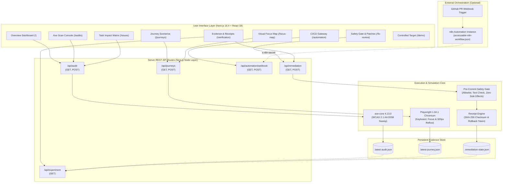
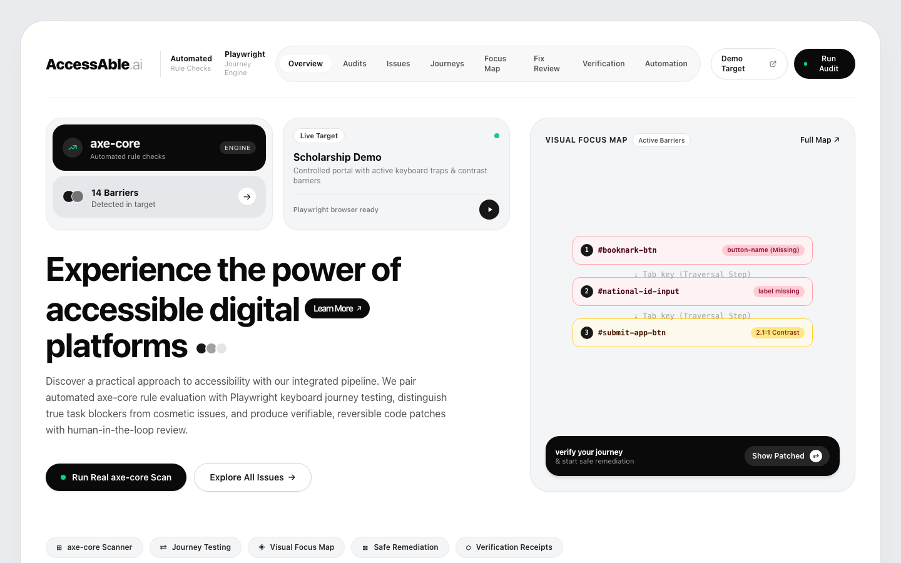
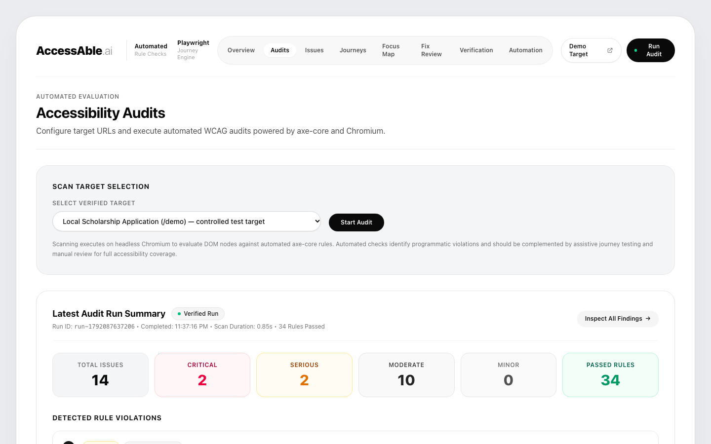
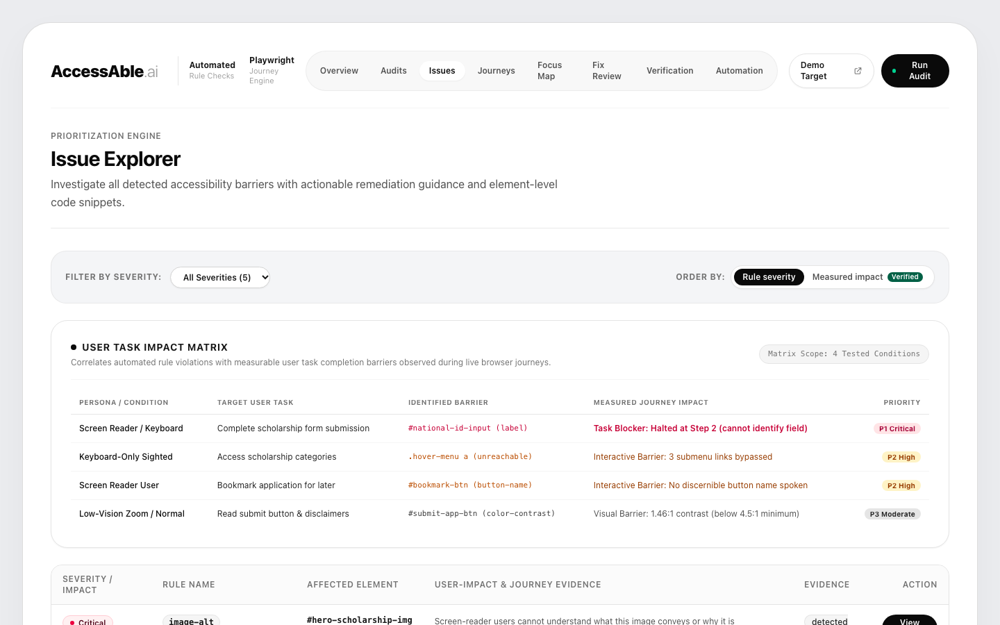
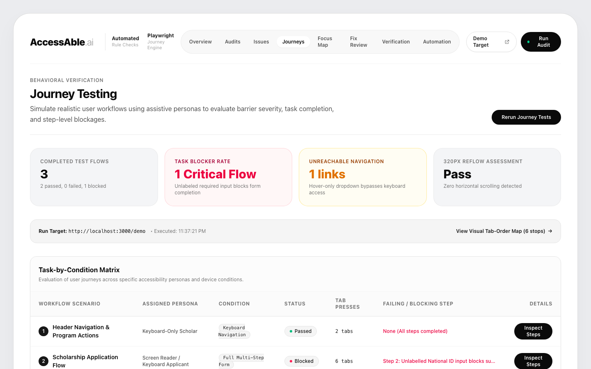
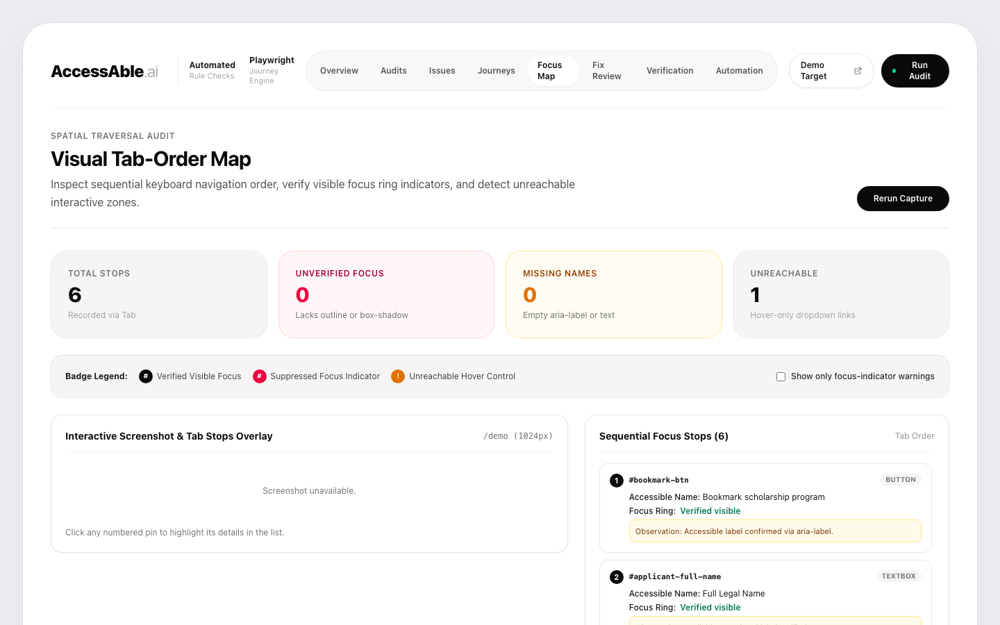
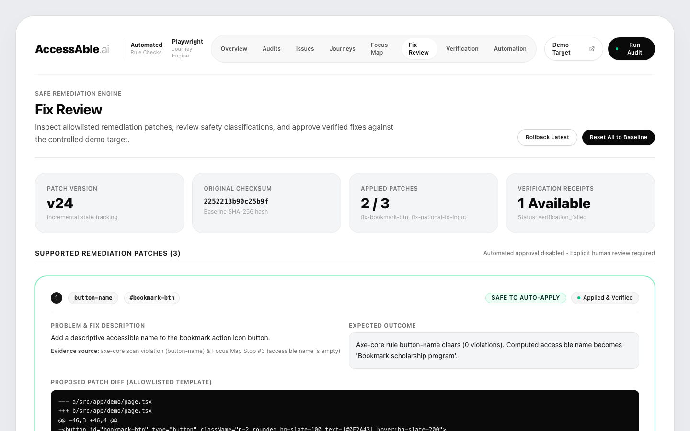
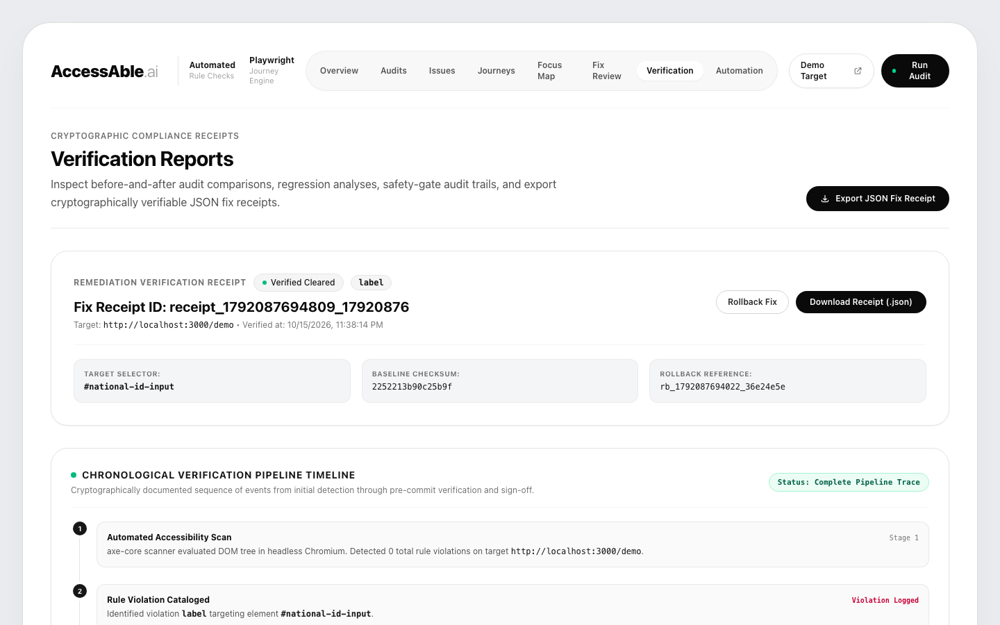
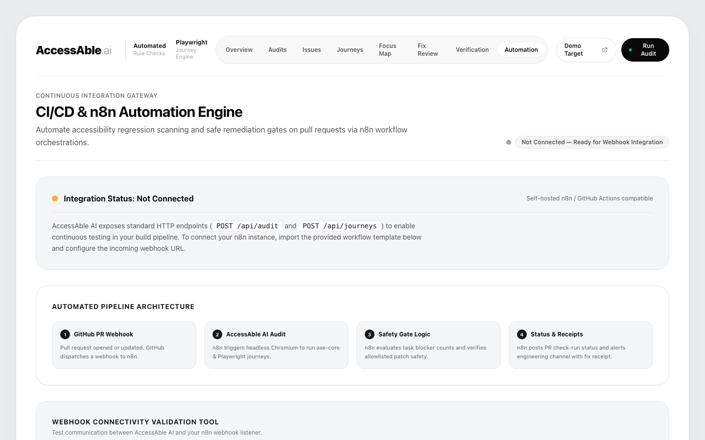
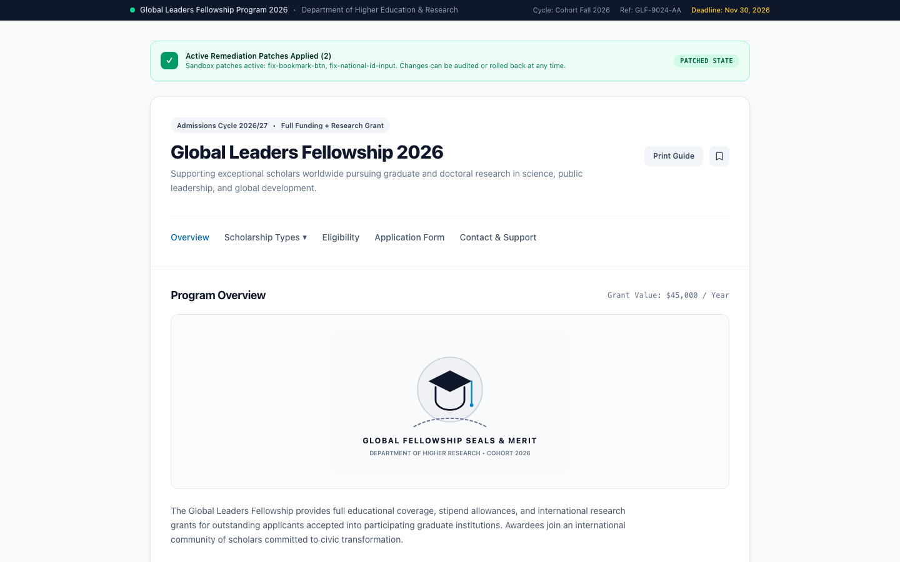

# AccessAble AI — The Invisible Barrier

> **BYTEATHON 2026 Round 2 — Problem Statement BYTE03: “The Invisible Barrier”**  
> **Repository:** [https://github.com/Abijeeva2007/Vestora](https://github.com/Abijeeva2007/Vestora)  
> **Branch:** `main` | **Latest Verified Commit:** [`e30cb29`](https://github.com/Abijeeva2007/Vestora/commit/e30cb29)  
> **Live Demo Target:** `/demo` & `/demo/sandbox` | **CI/CD Automation:** `/automation`  

[](https://nextjs.org/)
[](https://react.dev/)
[](https://www.typescriptlang.org/)
[](https://tailwindcss.com/)
[](https://playwright.dev/)
[](https://www.deque.com/axe/)
[](frontend/tests)
[](frontend)

---

## 1. Problem Statement & Context

### The Challenge: Problem Statement BYTE03 — “The Invisible Barrier”
Over 1.3 billion people worldwide experience significant disabilities. While the web is essential for education, employment, and government services, **over 96% of the world's top one million web pages contain accessibility errors**.

### The Core Problem: The Linters vs. Reality Gap
Existing automated accessibility tools (linters, static analyzers, and superficial browser extensions) suffer from a fundamental disconnect:
1. **Syntactic Warnings without Task Context:** Linters flag missing tags or color codes, but cannot determine whether an applicant using a screen reader or keyboard can actually finish an application form.
2. **Alert Fatigue:** Development teams are bombarded by dozens of low-priority warnings (e.g., generic landmark recommendations) while critical user task blockers (e.g., unlabelled form inputs that freeze screen readers) remain buried.
3. **Risky AI Hallucinations:** Generative AI "auto-fix" plugins often rewrite entire DOM trees, breaking CSS styling, destroying brand layouts, and silently mutating visible copy.

### The Solution: AccessAble AI
**AccessAble AI is an autonomous accessibility verification and remediation platform that bridges static rule auditing with real-world assistive user journeys, applies allowlisted deterministic patches through a strict pre-commit safety gate, and issues tamper-evident compliance receipts with optional CI/CD orchestration.**

---

## 2. Demonstration Video & Live Links

- **Demo Video:** `[DEMO VIDEO PLACEHOLDER — Recording link will be linked here upon final submission]`
- **5-Minute Judge Demonstration Plan:** See [`docs/DEMO_GUIDE.md`](docs/DEMO_GUIDE.md) for step-by-step route timings, speaker talking points, and recovery procedures.
- **Local Application Target:** [http://localhost:3000](http://localhost:3000)
- **Controlled Demo Scholarship Portal:** [http://localhost:3000/demo](http://localhost:3000/demo)
- **Remediated Sandbox Mirror:** [http://localhost:3000/demo/sandbox](http://localhost:3000/demo/sandbox)

---

## 3. Key Features

- **Dual-Engine Verification Architecture:**
  - *Automated Rule Engine:* Fast headless Chromium + `axe-core 4.13.0` sweep detecting WCAG 2.1 AA violations in under 1 second.
  - *Simulated User Journey Engine:* Playwright tests multi-step tasks across distinct assistive personas (Keyboard-Only Scholar, Keyboard and form-label check (simulated), and 320px Low-Vision Reflow).
- **User Task Impact Matrix:**
  - Correlates syntactic rule violations with measured journey task failures.
  - Categorizes findings into **Task Blockers** (halts user task completion), **Visual Barriers** (contrast/scaling hurdles), and **Structural Enhancements**.
- **Interactive Visual Focus Map:**
  - Automatically captures DOM bounding boxes and calculates sequential <kbd>Tab</kbd> order.
  - Overlays numbered indicators on the rendered viewport, spotlighting unreachable controls and missing accessible names.
- **Deterministic Pre-Commit Safety Gate:**
  - Fixes are never generated from free-form hallucinations; they use allowlisted, verified unified diff templates.
  - Enforces three mandatory pre-commit checks:
    1. *Allowlist template signature match*
    2. *Visible text preservation check* (guarantees visible labels are not altered)
    3. *Zero unexpected DOM side effects*
- **Tamper-Evident Verification Receipts:**
  - Issues structured JSON compliance receipts with SHA-256 baseline checksums, before/after violation deltas, and cryptographic rollback tokens (`rb_*`).
- **Read-Only Experiment Comparison (`/api/experiment`):**
  - Directly compares baseline audit data with post-remediation audit data, backed by persistent JSON storage (`.latest-audit.json`).
  - Reports an explicit `unavailable` status when no audit data exists, refusing to fabricate metrics.
- **CI/CD Webhook Gateway & n8n Compatibility:**
  - Dedicated `/api/automation/webhook` endpoint with secret header verification (`x-n8n-secret` / Bearer token).
  - Ready-to-import workflow template (`accessable-n8n-workflow.json`) for GitHub PR validation.
- **Mobile Responsive Guarantee (320px):**
  - Verified across all 10 application routes at a 320px viewport width with **zero document-level horizontal overflow** and zero global `overflow-x: hidden` hacks.

---

## 4. Tech Stack & Architectural Rationale

The project uses a focused, verified technology stack. Every listed tool is substantiable directly from the codebase:

| Technology | Role in AccessAble AI | Architectural Rationale |
|:---|:---|:---|
| **Next.js 16.4.1** | Application Framework & Server APIs | Provides React Server Components, high-performance static rendering, and integrated Node.js API routes (`/api/*`) in a unified codebase. |
| **React 19.3.0** | Interactive User Interface | Powers the responsive dashboard, live scan triggers, focus-map canvas, and receipt explorer. |
| **TypeScript 5** | Strict Type Safety | Enforces type contracts across audit structures (`AuditRun`, `JourneyRun`), fix proposals (`FixProposal`), safety gates (`SafetyGateResult`), and verification receipts (`FixReceipt`). |
| **Tailwind CSS 4** | Accessible UI Styling | Enables modern, utility-first styling with WCAG-compliant color tokens, responsive container queries, and strict 320px reflow compliance without CSS overflow clipping. |
| **Playwright 1.64.1** | Real Browser Automation | Drives headless Chromium to simulate authentic assistive keyboard journeys, tab-stop sequences, and 320px viewport reflow. |
| **axe-core 4.13.0** | Accessibility Rule Engine | Executes battle-tested WCAG 2.1 AA rule algorithms directly inside the real browser DOM. |
| **REST API Layer** | Modular Subsystem Communication | Server routes connect the dashboard UI, Chromium audit runner, journey runner, safety gate, and external CI/CD webhooks. |
| **SHA-256 Checksums** | Receipt Integrity | Generates deterministic checksum data on baseline HTML to track file integrity across remediation cycles. *(Note: Checksums are used for data integrity validation, not digital certificate signing).* |
| **n8n Webhook Integration** | Pipeline Automation | Integrates with external n8n workflow instances via authenticated webhooks to orchestrate PR checks and issue blocking reports. |
| **Git & GitHub** | Version Control & Collaboration | Version tracking, atomic pull-request validation, and repository distribution. |

> **Tech Stack Integrity Notice:** AccessAble AI does not claim external AI model providers, external vector databases, or commercial monitoring services. The platform runs entirely self-contained with deterministic safety-gated remediation.

---

## 5. System Architecture

The following diagram illustrates the complete AccessAble AI pipeline, from user initiation through automated auditing, journey evaluation, safety-gated remediation, and CI/CD webhook triggers:



---

## 6. End-to-End Workflow

```
┌─────────────────┐       ┌─────────────────┐       ┌─────────────────┐
│ 1. Rule Audit   │ ───>  │ 2. Journey Test │ ───>  │ 3. Impact Matrix│
│ (axe-core DOM)  │       │ (Playwright)    │       │ (Prioritize)    │
└─────────────────┘       └─────────────────┘       └─────────────────┘
         │                                                   │
         ▼                                                   ▼
┌─────────────────┐       ┌─────────────────┐       ┌─────────────────┐
│ 6. Verified     │ <───  │ 5. Sandbox Fix  │ <───  │ 4. Safety Gate  │
│ Receipt Issued  │       │ & Re-Scan       │       │ (Pre-Commit)    │
└─────────────────┘       └─────────────────┘       └─────────────────┘
         │
         ▼
┌─────────────────┐
│ 7. CI/CD Gate   │
│ (n8n Webhook)   │
└─────────────────┘
```

1. **Rule Audit (`/audits`):** Headless Chromium inspects the target DOM. `axe-core` flags syntactic WCAG 2.1 AA violations.
2. **Journey Simulation (`/journeys`):** Playwright executes realistic assistive flows (keyboard navigation, form submission, 320px reflow), calculating tab stops and identifying where users get stuck.
3. **Task Impact Correlation (`/issues`):** Violations that directly block assistive personas from completing a task are prioritized as **Task Blockers**.
4. **Safety Gate Review (`/fix-review`):** Developers inspect allowlisted diff proposals. The safety gate validates selector isolation and verifies visible text remains intact.
5. **Sandbox Application & Re-Scan:** The fix is applied to the controlled sandbox environment. The scanner re-runs automatically to confirm the violation is cleared without introducing regressions.
6. **Receipt Issuance (`/verification`):** A cryptographic Fix Receipt is generated with SHA-256 baseline checksums, before/after metrics, and a rollback token.
7. **CI/CD Enforcement (`/automation`):** An external n8n workflow or GitHub Action queries `/api/automation/webhook` to reject pull requests containing blocking accessibility barriers.

---

## 7. Application Visual Walkthrough

All screenshots below are captured directly from the live, running application:

### Overview Dashboard (`/`)
*Real-time accessibility score, barrier distribution, and assistive persona health indicators.*


### Automated Rule Audit Console (`/audits`)
*Direct axe-core 4.13.0 rule execution displaying severity breakdowns and DOM selectors.*


### User Task Impact Matrix (`/issues`)
*Correlating static syntax violations with live user task barriers.*


### Playwright User Journey Scenarios (`/journeys`)
*Multi-step assistive persona journeys showing Step 2 blocker on unlabelled inputs.*


### Visual Keyboard Focus Map (`/focus-map`)
*Numbered sequential tab stops with bounding-box highlights on unlabelled controls.*


### Pre-Commit Safety Gate & Allowlist Fix Review (`/fix-review`)
*Unified diff inspection with mandatory text preservation and selector containment checks.*


### Chronological Evidence Timeline & Verification Receipt (`/verification`)
*Tamper-evident receipt with SHA-256 baseline checksum, before/after comparison, and instant rollback.*


### CI/CD Webhook Gateway & n8n Trigger (`/automation`)
*Automated PR gate tester and downloadable `accessable-n8n-workflow.json`.*


### Controlled Demo Target: Fellowship Portal (`/demo`)
*Real-world scholarship application target containing intentional, controlled accessibility hooks.*


---

## 8. Installation & Local Setup

### Prerequisites
- **Node.js:** v20.0.0 or higher (tested on Node v20 and v26)
- **npm:** v10.0.0 or higher
- **Operating System:** macOS, Linux, or Windows (WSL recommended)

### 1. Clone the Repository
```bash
git clone https://github.com/Abijeeva2007/Vestora.git
cd Vestora
```

### 2. Install Dependencies
```bash
cd frontend
npm install
```

### 3. Install Playwright Chromium Browser
Playwright requires the Chromium browser binary to execute journey simulations and headless axe audits:
```bash
npx playwright install chromium
```

### 4. Configure Environment Variables
```bash
cp .env.example .env.local
```
*(Review `.env.local` — defaults work out of the box for local development).*

### 5. Run the Automated Test Suite
```bash
npm test
```
*Executes all 27 tests across 8 suites (WCAG contrast math, safety gate evaluation, state transitions, receipt integrity, and API validation).*

### 6. Build the Application
```bash
npm run build
```
*Compiles all 16 static and dynamic routes cleanly with Webpack and strict TypeScript checking.*

### 7. Launch the Production Server
```bash
npm start
```
Open **[http://localhost:3000](http://localhost:3000)** in your browser.

---

## 9. Environment Variables Specification

The project uses `.env.example` as a template. Only variables genuinely utilized in source code are configured:

```ini
# Application Port & Environment
PORT=3000
NODE_ENV=development
NEXT_PUBLIC_APP_URL=http://localhost:3000
ACCESSABLE_API_URL=http://localhost:3000

# Scanner Target Configuration
TARGET_URL=http://localhost:3000/demo

# Optional: n8n Webhook & CI/CD Gate Security
# When set, callers must provide 'x-n8n-secret' or 'Authorization: Bearer <secret>'
N8N_WEBHOOK_SECRET=your_n8n_webhook_secret_here

# Optional: URL of an external n8n workflow instance
N8N_WEBHOOK_URL=http://localhost:5678/webhook/accessable-pr-check
```

---

## 10. REST API Specification

All endpoints reside under `/api/*` and return standard JSON payloads:

### 1. `/api/audit`
- **Supported Methods:** `GET`, `POST`
- **Purpose:** Sweeps the target DOM using Playwright and axe-core 4.13.0.
- **Inputs (`POST`):**
  ```json
  { "targetUrl": "http://localhost:3000/demo" }
  ```
  *(Optional: defaults to `/demo`).*
- **Security Restrictions:**
  - Validates JSON format: malformed JSON, array bodies, or unsupported keys return **HTTP 400**.
  - Strict SSRF protection: scanning is restricted strictly to `/demo` on `localhost` / `127.0.0.1` or the hosting domain. External URLs return **HTTP 403 Forbidden**.
- **Outputs:** `{ id, timestamp, status, durationMs, passesCount, issueCounts, issues }`.

### 2. `/api/journeys`
- **Supported Methods:** `GET`, `POST`
- **Purpose:** Launches multi-step browser scenarios under assistive constraints (keyboard, screen reader, 320px reflow).
- **Security Restrictions:** Enforces local `/demo` origin matching (external URLs return **HTTP 403**).
- **Outputs:** `{ id, timestamp, target, status, tasks, focusStops, viewportWidth, horizontalOverflow320px }`.

### 3. `/api/remediation`
- **Supported Methods:** `GET`, `POST`
- **Purpose:** Manages allowlisted remediation patches, evaluates safety gates, and issues verification receipts.
- **Inputs (`POST`):**
  - **Apply Patch:** `{ "action": "apply", "fixId": "fix-national-id-input" }`
  - **Rollback:** `{ "action": "rollback", "rollbackToken": "rb_..." }`
  - **Reset Baseline:** `{ "action": "reset" }`
- **Pre-Commit Safety Evaluation:** Validates against `SUPPORTED_FIXES`, verifies visible text preservation, and confirms zero unexpected DOM changes before state is updated.
- **Outputs:** `{ success, receipt, rollbackToken, state }`.

### 4. `/api/experiment`
- **Supported Methods:** `GET`
- **Purpose:** Read-only comparison endpoint contrasting real baseline data against post-remediation data.
- **Integrity Guarantee:** If no audit has been run, or if no patches are active, it returns `status: "unavailable"` with an informative message rather than inventing metrics.
- **Outputs:** `{ experimentId, status, target, isComplete, baseline, postRemediation, comparison: { resolvedFindings, remainingFindings, newlyIntroducedFindings, taskImpactChanges }, storageMechanism }`.

### 5. `/api/automation/webhook`
- **Supported Methods:** `GET`, `POST`
- **Purpose:** External CI/CD gateway for automated PR checks and n8n orchestration.
- **Security:** When `N8N_WEBHOOK_SECRET` is set in the environment, callers must supply `x-n8n-secret: <secret>` or `Authorization: Bearer <secret>`. Invalid requests return **HTTP 401 Unauthorized**.
- **Supported Actions:** `"audit"`, `"journey"`, `"test"`, `"status"`.
- **Outputs:** `{ executionId, timestamp, status, action, message, target }`.

---

## 11. Verified Testing Results & Reliability Evidence

All test metrics below reflect actual execution on the current repository commit:

### 1. Automated Test Suite (`npm test`)
- **Total Test Cases:** 27
- **Test Suites:** 8
- **Results:** **27 Passed, 0 Failed, 0 Skipped**
- **Test Categories:**
  - *WCAG Contrast Calculation:* Mathematical verification of 21:1 (black/white), 1:1 (identical), baseline failure (1.46:1), and patched pass (5.97:1).
  - *Allowlisted Patch Verification:* Integrity check of all 3 registered templates (`fix-bookmark-btn`, `fix-national-id-input`, `fix-submit-app-btn`).
  - *Pre-Commit Safety Gate:* Rejection of unknown patches, selector containment check, label association, and visible text preservation.
  - *State Transitions & Rollback:* Version incrementing, snapshot preservation, and restoration verification.
  - *Fix Receipt Schema:* Cryptographic checksum validation and mandatory audit fields.
  - *Automation Webhook:* Secret header matching, execution ID generation, and routing.
  - *Audit API & Validation:* Malformed JSON handling (HTTP 400), array rejection, unsupported field rejection, external URL blocking (HTTP 403), experiment status, and favicon verification.

### 2. Viewport Reflow & Overflow Verification (320px)
Evaluated via Playwright Chromium measuring `document.documentElement.scrollWidth` at a 320px viewport:
- **Result:** **0px horizontal overflow across all 10 application routes** (`hasOverflow: false`).
- Zero reliance on global `overflow-x: hidden` hacks.

### 3. Dashboard Accessibility Audit (axe-core)
Audited using `@axe-core/playwright` across all 8 internal dashboard routes:
- **Result:** **0 accessibility violations** across `/`, `/audits`, `/issues`, `/journeys`, `/focus-map`, `/fix-review`, `/verification`, and `/automation`.

---

## 12. Pre-Commit Safety Gate & Remediation Mechanics

```
Proposed Patch  ──>  [ Allowlist Verification ]  ──>  [ Text Preservation Check ]  ──>  [ Sandbox Application ]
                             │                                   │                               │
                          (Reject)                            (Reject)                     (Re-Audit Delta)
                             │                                   │                               │
                             ▼                                   ▼                               ▼
                      HTTP 400 Error                      HTTP 400 Error                Fix Receipt Issued
```

AccessAble AI enforces a strict safety philosophy:
1. **No Hallucinated Code:** Remediation is restricted to deterministic, peer-reviewed diff templates registered in `SUPPORTED_FIXES`.
2. **Visible Text Preservation:** Before applying a form label or button patch, the engine compares normalized strings between original and modified nodes. If visible text changes by even one character, the safety gate fails immediately.
3. **Contrast Calculation:** Contrast fixes are verified mathematically using standard WCAG 2.1 relative luminance formulas:
   $$L = 0.2126 \cdot R + 0.7152 \cdot G + 0.0722 \cdot B$$
   $$\text{Contrast Ratio} = \frac{L_1 + 0.05}{L_2 + 0.05}$$
   The submit button patch elevates contrast from **1.46:1** to **5.97:1**, surpassing the WCAG AA 4.5:1 requirement.
4. **Instant Rollback Tokens:** Every state change saves a full rollback snapshot. A single click or API call reverts the sandbox to its exact pre-patch state.

---

## 13. Automation & n8n Integration

AccessAble AI includes a complete n8n workflow definition in [`accessable-n8n-workflow.json`](accessable-n8n-workflow.json).

### How to Configure n8n:
1. Open your n8n workspace (`http://localhost:5678`).
2. Click **Add Workflow** > **Import from File** > Select `accessable-n8n-workflow.json`.
3. Set your environment variables in n8n:
   - `N8N_WEBHOOK_SECRET`: Matches the secret configured in AccessAble AI.
   - `ACCESSABLE_API_URL`: `http://localhost:3000` (or your deployed URL).
4. Configure the Webhook node to listen to GitHub pull request events (`pull_request.opened`, `pull_request.synchronize`).
5. The workflow automatically:
   - Sends a `POST` request to `/api/automation/webhook` with `{ action: "journey" }`.
   - Parses the returned task impact.
   - If a **task_blocker** is found, posts a failure comment to the PR and fails the CI check.

---

## 14. Project Limitations & Future Roadmap

### Honest Current Limitations
- **Simulated Assistive Personas:** Playwright simulates programmatic keyboard navigation, focus management, and accessible name announcement. Physical screen reader speech synthesis (NVDA, JAWS, VoiceOver) and audio cadence still benefit from human QA validation.
- **Curated Patch Allowlist:** The platform currently includes 3 production-grade allowlisted remediation templates (`fix-bookmark-btn`, `fix-national-id-input`, `fix-submit-app-btn`). Expanding the allowlist to arbitrary custom components is planned for future releases.
- **Dynamic Single-Page Navigation:** Audits currently target static or rendered server-side DOM. Multi-page SPAs with complex client-side session states require step-by-step journey scripting.

### Roadmap & Future Enhancements
- [ ] Direct GitHub App integration for automatic inline PR code suggestions.
- [ ] Support for WCAG 2.2 criteria (Focus Appearance, Target Size Minimum, Dragging Movements).
- [ ] Integration with real VoiceOver and NVDA audio stream capture in headless container environments.
- [ ] User testing telemetry feedback loop comparing automated task completion against actual human user trials.

---

## 15. Repository & Submission Metadata

- **Event:** BYTEATHON 2026 Round 2
- **Track:** Problem Statement BYTE03 — “The Invisible Barrier”
- **Team / Author:** AccessAble AI Core Engineering Team
- **Repository:** [https://github.com/Abijeeva2007/Vestora](https://github.com/Abijeeva2007/Vestora)
- **License:** MIT License
